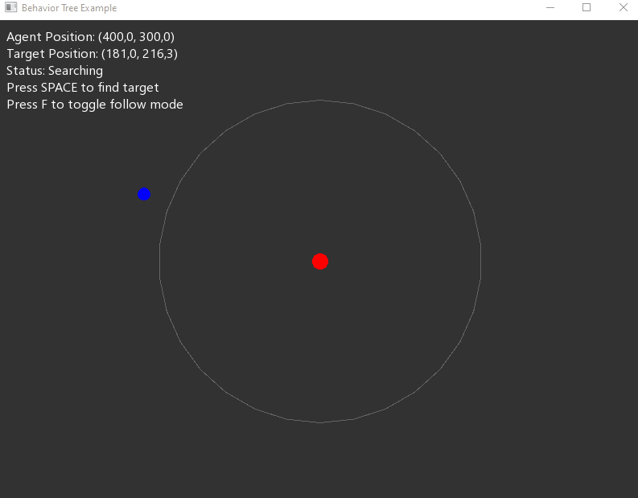
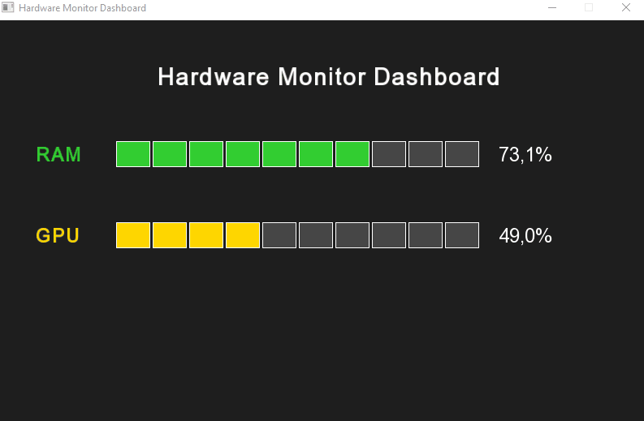
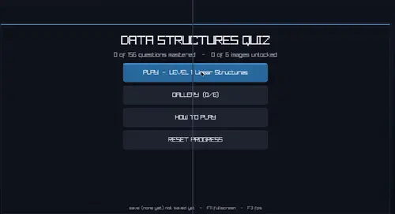
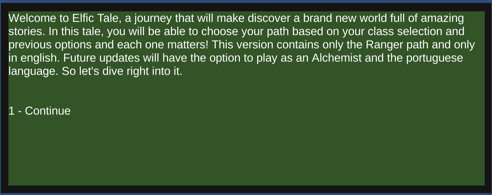
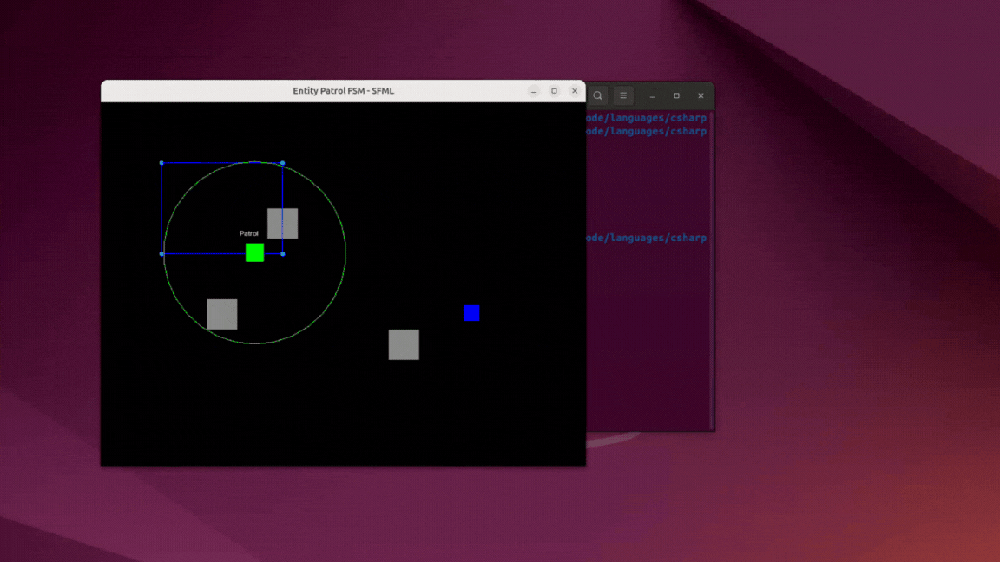
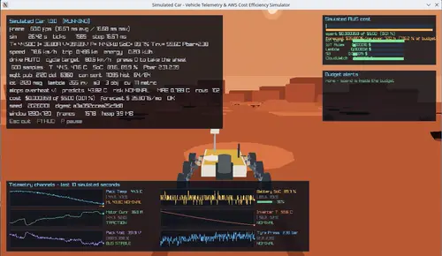

<h3 align="center"> Featured Projects & Demos </h3>

<table align="center" width="100%">
  <tr>
    <td align="center" width="16.66%" valign="middle">
      
       
      <b>Decision Tree</b>
    </td>
    <td align="center" width="16.66%" valign="middle">
      
       
      <b>Dashboard SFML</b>
    </td>
    <td align="center" width="16.66%" valign="middle">
      
       
      <b>C Quiz Raylib</b>
    </td>
    <td align="center" width="16.66%" valign="middle">
      
       
      <b>Elfic Tale</b>
    </td>
    <td align="center" width="16.66%" valign="middle">
      
       
      <b>FSM AI Patrol</b>
    </td>
    <td align="center" width="16.66%" valign="middle">
      
       
      <b>3D Rover Sim</b>
    </td>
  </tr>
</table>

---

I combine 15+ years of IT expertise with deep technical range to build intelligent systems that deliver measurable business results. Thriving beyond Moebius Syndrome and paralysis daily, I've built a career defined by resilience, rapid adaptation, and solving high-stakes technical challenges, always with an eye on real impact:

Currently expanding into three formal tracks, but not limited to:

- AI & Cloud Security Engineer - Scalable MLOps pipeline deployment, AI Agents Orchestration in the Cloud, Cloud FinOps, Cloud Security.

- Computer & Mechanical Engineering Research - Embedded AI (Edge Computing), Board Support Package, Automotive Mechatronics, Android Automotive OS, Computer Vision for Vehicles and Digital Twins.

- Game Dev - 3D Games + Animations with Unity, AI for Games, Computer Graphics.

If you have a project or job offer that is not aligned with my overall experience, fret not! Because I'm sure we can find a common ground! 

Let's connect!
  
---

---

### 🧰 Technologies used

<h3 align="center">/ languages /</h3> <!-- Python, Java, Bash, HTML, MD -->
  

    
  

  <h3 align="center">/ software /</h3> <!-- Linux, Arch, VSCode, Git, Discord-->
  

    
  

  <h3 align="center">/ homelab /</h3> <!-- Proxmox, Docker, -->
  

    
  

  
---

### 🔭 Goals for 2022-2030
- Finish all the degrees I'm currently pursuing (Games Development and Automotive Mechatronics Engineering).
- Begin a Masters Degree and then a PhD in Computer Science (focusing on Formal Languages or Machine Learning), Mechatronics Engineering (Embedded Systems for Automotive), Mechanical Engineering (Digital Twins, or Additive Manufacture), Aerospace Engineering (Electronics for Aerospace or Propulsion), Information Technology (AI for Games) and Electrical Engineering (Embedded AI).
- Become an advanced programmer in C, C# and Python.
- Get certifications for Cloud Computing and Information Security.
- Get a job at: Apple, Canonical, Red Hat, NASA, Lockheed, Google, Tesla, Sega :D  

---

### ⚡ Fun fact
- In love with automation of all sorts of things: machines, games, industry, home and boring office stuff!
- Trying to be the best polymath of the neighbourhood!

---
